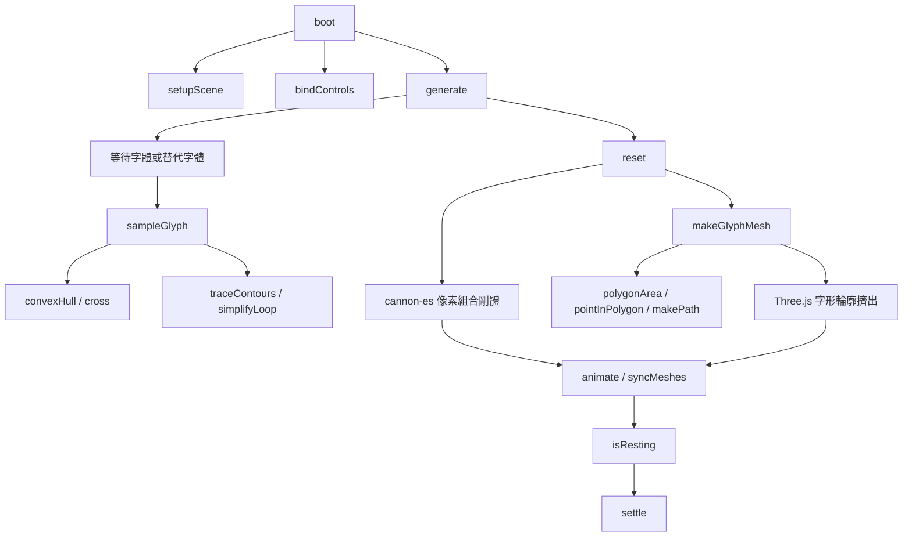
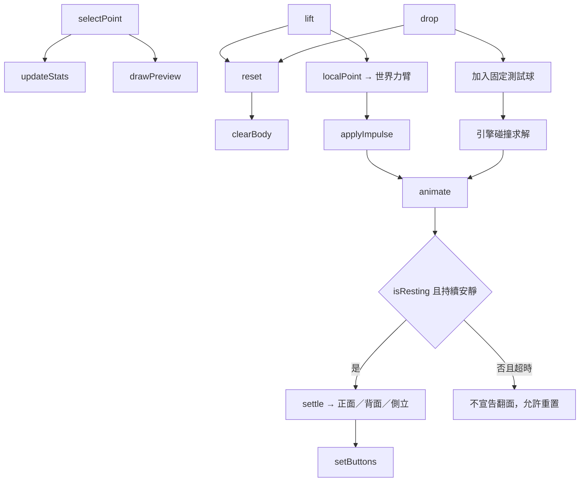
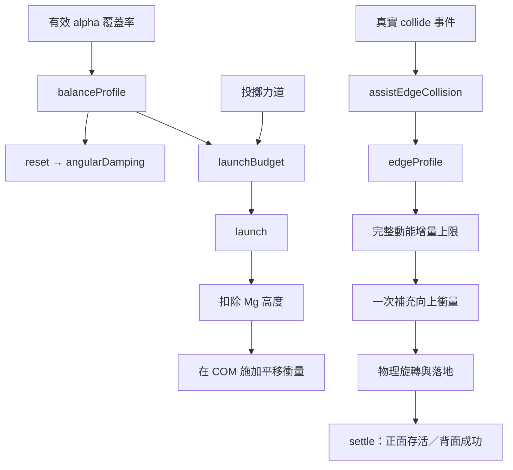
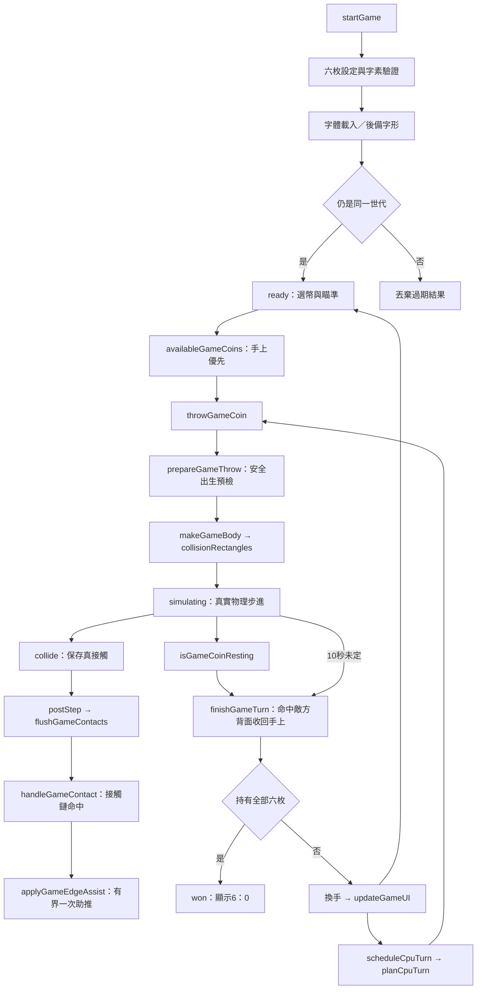

# 尪仔標：硬幣版 — 第一版架構

實作為單一 [index.html](index.html)，包含淺色設定介面、單人對電腦、單機雙人、完整三幣開局與六幣全拿回合，以及保留的物理測試。玩法見 [規格書](docs/specification.md)。

## 模組與協作者

本模組沒有自訂類別。Three.js 負責顯示，cannon-es 負責接觸與剛體求解，Canvas 負責字形取樣；外部類別不視為本專案定義。顯示模型和碰撞模型共用取樣來源、重心、主軸及姿態，但有不同解析度。

## 字形與物理資料

- `config` 固定取樣解析度、字形框尺寸、厚度、密度、重力及 alpha 門檻。
- `state` 持有目前字形模型、施力位置、物理世界、顯示資源與結算狀態。
- `state.assistUsed` 避免同一球體在多個格上觸發重複加成，`lastAssist` 記錄真正施加的量；`lastLaunch` 記錄攻方能量預算與實際上限。
- `elements` 以 HTML 元素 ID 為鍵、對應 DOM 元素為值，綁定設定與結果畫面。
- `cache` 以輸入字形與實際字體家族組合作為鍵，保存本次網頁中的取樣資料。
- `game` 保存六枚的唯一身分、手上／桌面位置、目前主人、回合、瞄準、力道、AI 計時器及世代；`coin.body === null` 表示在手上。設定快照不可被晚到的字體載入或舊計時器覆寫。
- 像素的 alpha 是有效材料覆蓋率；所有字形共用材料密度。背景碰撞格為整格近似，質量以覆蓋率估計。
- 質量中心成為剛體原點；先對角化桌面上的質量分布，再以平行軸定理求主軸慣量，覆寫引擎預設包圍盒慣量。正式對局另由 `balanceGameModel` 均勻縮放重量與慣量，保留重心及原始校準快取，使實際進攻能量單調下降、防守質量與耗散單調上升。
- `model.canvas` 保存同一輸入與字體的原始彩色字形；`model.contours` 保存顯示輪廓。正面 UV 對回字形圖，背面與側面使用辨識色。
- 輪廓外框／孔洞由有向面積辨識；洞附屬於包含它的最小外框。顯示輪廓有厚度，但不額外貢獻質量。

## 操作與結算

固定世界步長為 1/120 秒。停止判定分别檢查線速度與角速度，並確認桌面接觸；超過測試時間仍未停止，不偷偷強制翻面。重置會移除舊剛體、幾何、材質及紋理，避免重复操作累積顯示資源。

## 遊戲平衡與邊緣加成

O/D 是使用者要求的互補遊戲配置，非新自然定律。發射上限先計算可施加總能量，再將其中一部分分配高度，其餘施加 COM 衝量。邊緣加成使用相對接觸點的力臂與逆慣量，限制 `ΔKE = bJ + kJ²/2`，包含當前動量的交叉項。真正的接觸方盒保持不可見。

## 對局與物件生命週期

每次捕獲先快照符合條件的所有枚，再轉移到攻方手上，避免先移除下層影響同時結算。移除、拾起或捕獲會喚醒其餘枚並清除支撐快照。只按手上＋桌面的主人數判6：0。

正式對戰啟用自動休眠；物理測試保留不自動休眠的校準模式。每枚 sleep 回呼從真實接觸取得支撐路徑；當引擎省略休眠接觸時，只接受仍存在、位置與姿態未變且速度低的證據。疊放可經靜止薄片傳到地面，純空中環不可作支撐。新投擲與捕獲清除舊快照並喚醒，避免浮空殘留。

投擲以共同能量預算分配位能、平移與旋轉，電腦和真人同路徑。電腦只選合法枚、目標與力度，難度改變瞄準誤差。它不改寫姿態或所有權。回設定與重開使用 `epoch` 及 timer 清理隔離舊動作。

## 遊戲函式責任

| 函式 | 責任與回呼 |
| --- | --- |
| `getGameElement` | 以固定 ID 存取 DOM，使用者字形與名字只透過 textContent 顯示。 |
| `bindGameControls` | 綁定開始、重開、投擲、回設定、模式、力度、物理測試、桌面及鍵盤回呼。 |
| `startGame` | 驗證六枚、建立輸入快照、字體／字形載入與 epoch 檢查、清理舊場景、建立對局；player map 回呼只建立安全名稱與色彩。 |
| `setupGameBoard` | 建立固定邊界與非物理瞄準記號，重開時移除舊牆。 |
| `clearGameBodies`、`removeGameBody` | 移除對局或單枚的剛體、幾何、材質、紋理與支撐紀錄。 |
| `leaveGame` | 取消 CPU、隔離舊世代、清理對局並還原設定／物理测试容器。 |
| `availableGameCoins` | filter 所有權與手上枚，實現手上優先。 |
| `selectGameCoin` | 驗證 ready 與合法枚後更新選取。 |
| `makeGameBody` | 合併背景碰撞區，保留主軸質量／慣量；collide 回呼保存接觸雙方、局部力臂與入射速度，sleep 回呼保存真實支撐。 |
| `balanceGameModel` | 由覆蓋率限定遊戲重量，非原地縮放各像素／慣量／穩定值；保留原始模型快取、重心與輪廓。 |
| `collisionRectangles` | 合併相鄰完整行段，保留遮罩空洞與佔據區；map 回呼建立格座標集合。 |
| `throwGameCoin` | 保存本次攻擊者、拾起合法枚、喚醒其他枚、分配位能／平移／旋轉，開始真實模擬。 |
| `handleGameContact` | find 物件身分，沿實際接觸傳遞命中，排除自己並限制每枚的助推次數。 |
| `flushGameContacts` | 每步求解完成後清空接觸佇列；沿真實接觸傳遞六枚命中關係，再以目前姿態還原力臂、處理一次助推。 |
| `prepareGameThrow` | 保持共同能量／速度預算，預檢八個入射方向的實際出生包圍盒；排除牆及既有堆疊，拒絕時不改回合或拿走枚。 |
| `updateGameRestitution` | 更新獨立字形／桌面接觸材質的彈性與滑桿，不改校準接觸材質。 |
| `beginGameDrag`、`updateGameDrag` | 限真人準備回合的底部單指手勢；記錄起点、由距離設定力度、投影落點及 SVG 箭頭；非底部仍可點選瞄準。 |
| `endGameDrag`、`cancelGameDrag` | 有效上拖放開才投擲；清除指標捕獲、手勢與箭頭，短拖／取消不出手。 |
| `applyGameEdgeAssist` | 在真实接觸力臂施加有動能增量上限的補充衝量，不指定結果。 |
| `isGameCoinResting` | 分別檢查速度，BFS 真實支撐路徑，或驗證休眠快照；map 回呼記錄姿態證據。 |
| `validGameSupportSnapshot` | every/some 檢查休眠路徑中的物件仍存在、未移位、未旋轉且未移動。 |
| `wakeGameCoins` | 清除支撐紀錄並喚醒現有桌面枚。 |
| `finishGameTurn` | 正常等待或超時結算、快照多枚捕獲、維持身分回手、檢查6：0、換手與 AI 排程。 |
| `planCpuTurn` | 對手穩定度排序，內部 `attackScore` 以受限能量和質量傳遞估計選攻方，求有誤差的邊緣目標，回傳實際出手計畫。 |
| `scheduleCpuTurn` | 900ms 回呼驗 epoch／模式／玩家／狀態後，走同一投擲函式。 |
| `pickGameAim` | 射線與桌面相交，限制目標範圍並聚焦鍵盤；空中射線不變更目標。 |
| `moveAimMarker` | 同步瞄準記號位置。 |
| `handleGameKey` | 不攔表單操作；方向鍵微調、Enter 投擲，CPU 回合不可手動出手。 |
| `updateGameUI` | 更新安全名字、持有數、合法選幣按鈕、屬性、回合、勝利與紀錄；選幣回呼保留 id。 |
| `animateGame` | 同步所有 3D 字形姿態，累積穩定時間，正常或超時呼叫結算。 |

## 函式責任清單

| 函式 | 責任與主要分支 |
| --- | --- |
| `boot` | 載入固定版本函式庫、初始化、開始動畫；啟動失敗時提供提示。 |
| `setupScene` | 建立重力、桌面、固定相機、光源、格線與尺寸觀察器。 |
| `bindControls` | 綁定產生、重置、撞擊、點選與衝量滑桿；滑桿回呼只更新顯示。 |
| `generate` | 字素數量驗證、字體載入、逾時／失敗替代、快取、取樣與重置；非同步過期結果不覆寫。 |
| `sampleGlyph` | 字形繪製、alpha 取樣、像素質量、重心、主軸慣量、支撐輪廓及穩定能量；空字形拋出錯誤。 |
| `convexHull` | 去除重複角點、排序並建立上下凸包；使用 map/sort 回呼處理點座標。 |
| `cross` | 三點有向叉積，供凸包、邊界轉彎及共線簡化使用。 |
| `farthestCell` | forEach 掃描距重心最遠的像素，提供初始施力位置。 |
| `reset` | 釋放舊資源、建立像素剛體並套用主軸慣量，再建立完整 3D 字形、更新狀態。 |
| `localPoint` | 將字形框座標轉到以重心為原點的主軸座標。 |
| `makeGlyphMesh` | 分離外框與孔洞，產生擠出幾何、UV 與正背面材質；回呼查找孔洞的最小父外框。 |
| `traceContours` | 掃描不透明邊界，追蹤有向封閉輪廓；內部 `opaque` 檢查覆蓋，`add` 建立有向邊；對角交點優先右轉。 |
| `simplifyLoop` | filter 去除共線輪廓點，保持至少三點的封閉形狀。 |
| `polygonArea` | reduce 計算有向面積，區分外框與孔洞。 |
| `pointInPolygon` | 射線交點法判斷孔洞所屬外框。 |
| `makePath` | forEach 把影像點轉為主軸轉換前的 Shape/Path，形成外框或孔洞。 |
| `clearBody` | 移除剛體及顯示物件，逐一 dispose 幾何、材質與紋理。 |
| `updateStats` | 顯示质量、理論翻倒能量與所選力臂的單位衝量角速度。 |
| `balanceProfile` | alpha 覆蓋累加回呼產生互補攻守配置與真正角耗散。 |
| `launchBudget` | 驗證質量與力道，計算總能量並限制速度／衝量；無效質量回有限零值。 |
| `launch` | 重置真實字形，扣除位能後施加 COM 平移衝量，記錄實際能量。 |
| `edgeProfile` | 主軸接觸點轉回字形框，以 reduce/map/some 回呼求最近筆畫、邊界與局部覆蓋倍率。 |
| `assistEdgeCollision` | collide 回呼確認測試球與單次條件，完整動能限額內補充力臂衝量。 |
| `drawPreview` | 顯示完整字形紋理、重心與施力點，不繪製碰撞格。 |
| `selectPoint` | 將點選位置對應到有效像素；空白處顯示提示，忙碌或測試時拒絕操作。 |
| `lift` | 重置後在指定世界力臂施加向上衝量，顯示公式預測與實際初始角速度。 |
| `drop` | 重置後從所選位置上方落下固定球，接觸交由物理引擎求解。 |
| `setButtons` | 依載入、模型存在與執行狀態控制按鈕。 |
| `syncMeshes` | 將字形及球的姿態同步到顯示，並變換重心標記位置。 |
| `animate` | 固定步進、安靜時間累積、停止／逾時分支及逐幀繪製。 |
| `settle` | 再確認靜止與桌面接觸，以面法線分類正面、背面或側立。 |
| `isResting` | 分別檢查線／角速度，再以 contacts 回呼確認目標與桌面的接觸對。 |
| `resize` | 更新相機比例與畫布大小；供 ResizeObserver 回呼使用。 |

## 驗證與限制

### 對局驗收

[tests/game.cjs](tests/game.cjs) 由 Astra 維護，產品實作者不得改動驗收要求。

| 對局測試函式 | 責任 |
| --- | --- |
| `main`、`instrumentRoute`、`runChecks` | 啟動瀏覽器、停用自動 rAF、注入唯測試接點並逐項執行。 |
| `near`、`requireCondition`、`check` | 獨立容差與分項驗證。 |
| `newGame`、`owned`、`assertSix` | 透過設定初始化，查詢權屬與六枚唯一性。 |
| `place`、`backface`、`step`、`beginThrow` | 建立真剛體 fixture、姿態與固定物理步進，不偽造接觸資料。 |
| `setupPriorityCheck`、`boardReuseCheck` | 手上優先、合法選枚、重投及換手。 |
| `realCollisionCaptureCheck` | 真實碰撞→命中→捕獲入手→再次投擲，身分與物性保持。 |
| `exclusionCheck`、`multiAndWinCheck` | 非捕獲條件、多枚捕獲、5：1繼續與6：0勝利。 |
| `cpuAndRestartCheck`、`finishWithQueuedTimers`、`cpuTimerCheck` | AI 計畫、真正排程出手及過期世代隔離。 |
| `assertPartition`、`assertBodyMask`、`mergedGeometryCheck` | 以獨立遮罩逐格驗合併區與實際方盒，不填洞、不遺漏、不重疊。 |
| `gameEnergyCheck` | 真正出手的高度、平移與旋轉共用預算與速度／衝量上限。 |
| `airborneSpinCheck`、`restitutionCheck` | 驗偏心握持力臂與主慣量的空中反應，以及滑桿對真實地面及雙片碰撞的反彈效果。 |
| `pointerUiCheck` | 以真實滑鼠拖曳驗箭頭、預測落點、短拖取消、放開投擲與電腦回合鎖定。 |
| `recordGroundSupport`、`sleepingSupportCheck` | 以真正桌面接觸和產品自然休眠測試紀錄與空中失效。 |
| `supportedStackRemovalCheck`、`newThrowInvalidatesSupportCheck` | 失去下層支撐或重新投擲時，喚醒並失效舊紀錄。 |
| `sampleRawRectangle`、內部 `knownImage`、`normalizedBalanceCheck` | 解析覆蓋率階段驗重量、完整投擲能量、幾何與重心保持，以及不污染校準模型。 |
| `kineticEnergy`、`gameEdgeEnergyCheck` | 以世界慣量計算真正動能增量，驗攻方份額、一次助推、衝量上限且不直接改姿態／權屬。 |
| `deferredContactCheck`、`highBoundaryCheck` | 驗真正接觸在求解後才助推、動能上限與舊佇列隔離，以及高處飛向 x／z 牆的實際碰撞。 |
| `spawnSafetyCheck` | 驗成功出生的完整形狀在牆內且不重疊，能量不變；手中及桌面枚全阻塞拒絕時不改原對局。 |

### 獨立測試模組

[tests/physics.cjs](tests/physics.cjs) 由 GPT-6 Astra 撰寫，產品實作者不得修改測試要求。`main` 啟動瀏覽器並透過 `instrumentRoute` 僅在本地測試注入物理接點，再執行 `runPhysicsChecks`。測試使用固定步進，避免依賴實際動畫時序。

| 測試函式 | 責任 |
| --- | --- |
| `main` | 載入測試瀏覽器、檢查頁面錯誤、執行驗收並關閉瀏覽器。 |
| `instrumentRoute` | 對本地 HTML 加入測試接點，不修改正式 HTML。 |
| `runPhysicsChecks` | 協調六項獨立物理驗證，回傳結果。 |
| `near`、`requireCondition`、`check` | 浮點誤差比較、布林條件與分項結果收集。 |
| `sample`、內部 `knownImage` | 注入解析矩形影像，以獨立幾何取代裝置字體差異。 |
| `analytic` | 解析矩形積分，計算與產品獨立的質量、重心與張量預期值。 |
| `install`、`setPose` | 安裝測試模型，設定姿態、速度及接觸狀態。 |
| `verifyModel`、`verifyImpulse` | 驗證質量／重心／慣量不變量與世界座標衝量反應。 |
| `rectangleCheck`、`asymmetricCheck` | 規則矩形與非對稱 L 形的解析驗證。 |
| `materialCheck` | 密度與 alpha 有效覆蓋的縮放驗證。 |
| `leverageCheck` | 同一物件不同施力點的旋轉差異。 |
| `verdictCheck` | 桌面正背面、側立、空中與移動中的判面條件。 |
| `collisionCheck` | 固定步進下驗證實際球體接觸與動量交換。 |

攻守驗收另由 Astra 在 [tests/balance.cjs](tests/balance.cjs) 定義。測試檔同樣受到保護；主要驗證覆蓋率的攻守單調、互補預算、有界投擲與真正剛體耗散，不以顯示百分比冒充物理作用。

| 攻守測試函式 | 責任 |
| --- | --- |
| `main`、`instrumentRoute`、`runChecks` | 啟動測試瀏覽器、注入唯測試接點並協調八組驗收；主函式記錄 pageerror。 |
| `near`、`requireCondition`、`check` | 容差、條件與分項結果驗證。 |
| `sample`、內部 `knownImage` | 建立不同覆蓋率的解析矩形 fixture，避免依賴特定字體。 |
| `expectedBudget` | 以獨立規則计算能量、速度與衝量預期。 |
| `profileCheck`、`budgetCheck`、`inputCheck` | 攻守單調、完整發射公式及空白／無效質量／emoji 邊界。 |
| `launchCheck`、`dampingCheck` | 真正剛體的高度＋動能預算與角阻尼作用。 |
| `edgeProfileCheck` | 小接觸面積較大倍率、倍率有界及內部無加成。 |
| `kineticEnergy`、`edgeEnergyCheck` | 世界慣量總動能驗證，涵蓋既有速度交叉項與重複接觸保護。 |
| `edgeCollisionCheck`、內部 `recordContact` | 記錄真正球體接觸，確認只補一次衝量，且最後正面不淘汰。 |

物理公式與必要預期由 GPT-6 Astra 蒸餾並定義，記錄於 [physics-distillation.md](docs/physics-distillation.md)。三個屬性是同一物理模型的描述，不另行乘上攻防或成功率係數。

網頁需網路載入 Three.js、cannon-es 及 Noto 字體。標楷體和 emoji 外觀依裝置，取樣、紋理與物理同步使用實際顯示字形。低解析碰撞與高解析顯示輪廓之間有近似誤差；攻守配置有取捨，但不宣稱所有 Unicode 字形與配對勝率已相同。第一版不含 LAN 或 3～8 人對戰。
