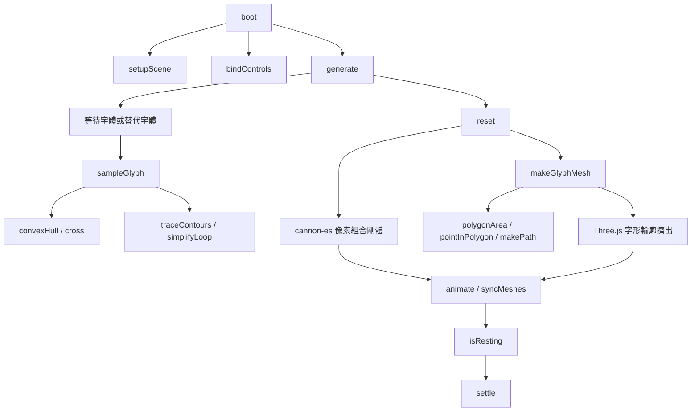
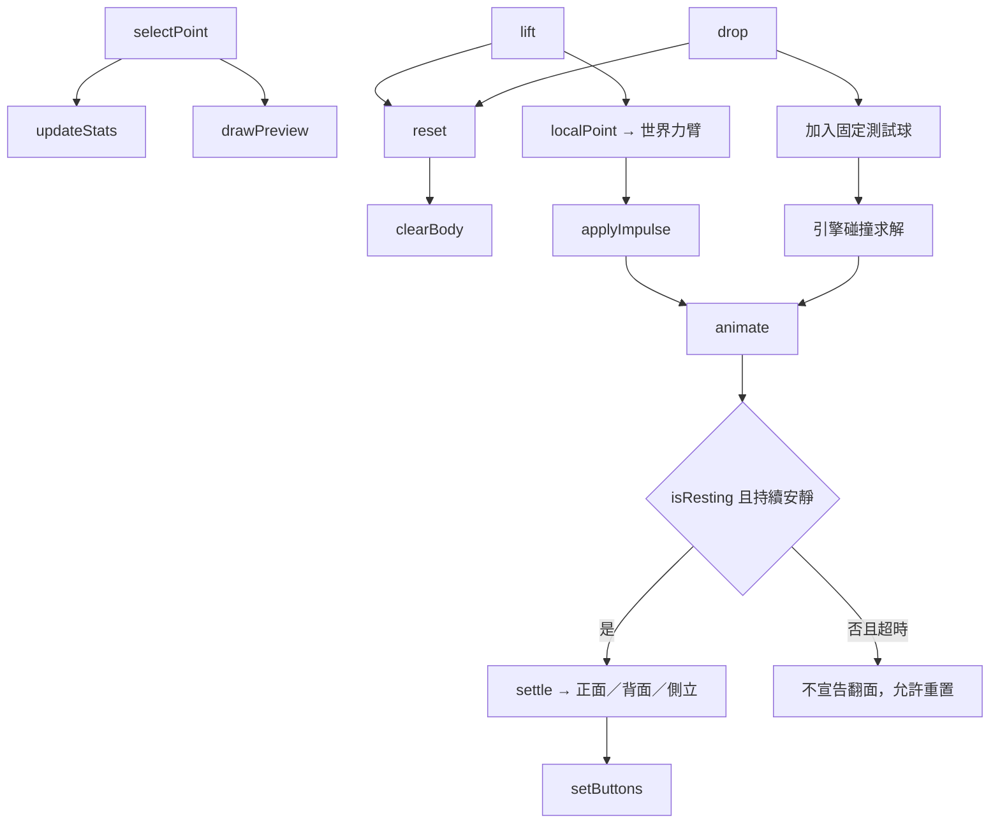

# 尪仔標：硬幣版 — 第一階段架構

目前實作為單一 [index.html](index.html) 的字形物理實驗原型。回合、奪幣、6：0 勝負及電腦玩家仍列在 [規格書](docs/specification.md)，尚未實作。

## 模組與協作者

本模組沒有自訂類別。Three.js 負責顯示，cannon-es 負責接觸與剛體求解，Canvas 負責字形取樣；外部類別不視為本專案定義。顯示模型和碰撞模型共用取樣來源、重心、主軸及姿態，但有不同解析度。

## 字形與物理資料

- `config` 固定取樣解析度、字形框尺寸、厚度、密度、重力及 alpha 門檻。
- `state` 持有目前字形模型、施力位置、物理世界、顯示資源與結算狀態。
- `elements` 以 HTML 元素 ID 為鍵、對應 DOM 元素為值，綁定設定與結果畫面。
- `cache` 以輸入字形與實際字體家族組合作為鍵，保存本次網頁中的取樣資料。
- 像素的 alpha 是有效材料覆蓋率；所有字形共用材料密度。背景碰撞格為整格近似，質量以覆蓋率估計。
- 質量中心成為剛體原點；先對角化桌面上的質量分布，再以平行軸定理求主軸慣量，覆寫引擎預設包圍盒慣量。
- `model.canvas` 保存同一輸入與字體的原始彩色字形；`model.contours` 保存顯示輪廓。正面 UV 對回字形圖，背面與側面使用辨識色。
- 輪廓外框／孔洞由有向面積辨識；洞附屬於包含它的最小外框。顯示輪廓有厚度，但不額外貢獻質量。

## 操作與結算

固定世界步長為 1/120 秒。停止判定分别檢查線速度與角速度，並確認桌面接觸；超過測試時間仍未停止，不偷偷強制翻面。重置會移除舊剛體、幾何、材質及紋理，避免重复操作累積顯示資源。

## 函式責任清單

| 函式 | 責任與主要分支 |
| --- | --- |
| `boot` | 載入固定版本函式庫、初始化、開始動畫；啟動失敗時提供提示。 |
| `setupScene` | 建立重力、桌面、固定相機、光源、格線與尺寸觀察器。 |
| `bindControls` | 綁定產生、重置、撞擊、點選與衝量滑桿；滑桿回呼只更新顯示。 |
| `generate` | 字素數量驗證、字體載入、逾時／失敗替代、快取、取樣與重置；非同步過期結果不覆寫。 |
| `sampleGlyph` | 字形繪製、alpha 取樣、像素質量、重心、主軸慣量、支撐輪廓及穩定能量；空字形拋出錯誤。 |
| `convexHull` | 去除重複角點、排序並建立上下凸包；使用 map/sort 回呼處理點座標。 |
| `cross` | 三點有向叉積，供凸包、邊界轉彎及共線簡化使用。 |
| `farthestCell` | forEach 掃描距重心最遠的像素，提供初始施力位置。 |
| `reset` | 釋放舊資源、建立像素剛體並套用主軸慣量，再建立完整 3D 字形、更新狀態。 |
| `localPoint` | 將字形框座標轉到以重心為原點的主軸座標。 |
| `makeGlyphMesh` | 分離外框與孔洞，產生擠出幾何、UV 與正背面材質；回呼查找孔洞的最小父外框。 |
| `traceContours` | 掃描不透明邊界，追蹤有向封閉輪廓；內部 `opaque` 檢查覆蓋，`add` 建立有向邊；對角交點優先右轉。 |
| `simplifyLoop` | filter 去除共線輪廓點，保持至少三點的封閉形狀。 |
| `polygonArea` | reduce 計算有向面積，區分外框與孔洞。 |
| `pointInPolygon` | 射線交點法判斷孔洞所屬外框。 |
| `makePath` | forEach 把影像點轉為主軸轉換前的 Shape/Path，形成外框或孔洞。 |
| `clearBody` | 移除剛體及顯示物件，逐一 dispose 幾何、材質與紋理。 |
| `updateStats` | 顯示质量、理論翻倒能量與所選力臂的單位衝量角速度。 |
| `drawPreview` | 顯示完整字形紋理、重心與施力點，不繪製碰撞格。 |
| `selectPoint` | 將點選位置對應到有效像素；空白處顯示提示，忙碌或測試時拒絕操作。 |
| `lift` | 重置後在指定世界力臂施加向上衝量，顯示公式預測與實際初始角速度。 |
| `drop` | 重置後從所選位置上方落下固定球，接觸交由物理引擎求解。 |
| `setButtons` | 依載入、模型存在與執行狀態控制按鈕。 |
| `syncMeshes` | 將字形及球的姿態同步到顯示，並變換重心標記位置。 |
| `animate` | 固定步進、安靜時間累積、停止／逾時分支及逐幀繪製。 |
| `settle` | 再確認靜止與桌面接觸，以面法線分類正面、背面或側立。 |
| `isResting` | 分別檢查線／角速度，再以 contacts 回呼確認目標與桌面的接觸對。 |
| `resize` | 更新相機比例與畫布大小；供 ResizeObserver 回呼使用。 |

## 驗證與限制

### 獨立測試模組

[tests/physics.cjs](tests/physics.cjs) 由 GPT-6 Astra 撰寫，產品實作者不得修改測試要求。`main` 啟動瀏覽器並透過 `instrumentRoute` 僅在本地測試注入物理接點，再執行 `runPhysicsChecks`。測試使用固定步進，避免依賴實際動畫時序。

| 測試函式 | 責任 |
| --- | --- |
| `main` | 載入測試瀏覽器、檢查頁面錯誤、執行驗收並關閉瀏覽器。 |
| `instrumentRoute` | 對本地 HTML 加入測試接點，不修改正式 HTML。 |
| `runPhysicsChecks` | 協調六項獨立物理驗證，回傳結果。 |
| `near`、`requireCondition`、`check` | 浮點誤差比較、布林條件與分項結果收集。 |
| `sample`、內部 `knownImage` | 注入解析矩形影像，以獨立幾何取代裝置字體差異。 |
| `analytic` | 解析矩形積分，計算與產品獨立的質量、重心與張量預期值。 |
| `install`、`setPose` | 安裝測試模型，設定姿態、速度及接觸狀態。 |
| `verifyModel`、`verifyImpulse` | 驗證質量／重心／慣量不變量與世界座標衝量反應。 |
| `rectangleCheck`、`asymmetricCheck` | 規則矩形與非對稱 L 形的解析驗證。 |
| `materialCheck` | 密度與 alpha 有效覆蓋的縮放驗證。 |
| `leverageCheck` | 同一物件不同施力點的旋轉差異。 |
| `verdictCheck` | 桌面正背面、側立、空中與移動中的判面條件。 |
| `collisionCheck` | 固定步進下驗證實際球體接觸與動量交換。 |

物理公式與必要預期由 GPT-6 Astra 蒸餾並定義，記錄於 [physics-distillation.md](docs/physics-distillation.md)。三個屬性是同一物理模型的描述，不另行乘上攻防或成功率係數。

原型需網路載入 Three.js、cannon-es 及 Noto 字體。標楷體和 emoji 外觀依裝置，取樣、紋理與物理同步使用实际顯示字形。低解析整格碰撞與高解析顯示輪廓之間有近似誤差；尚不包含完整對戰操作、硬幣間高速接觸驗證或出界規則。
